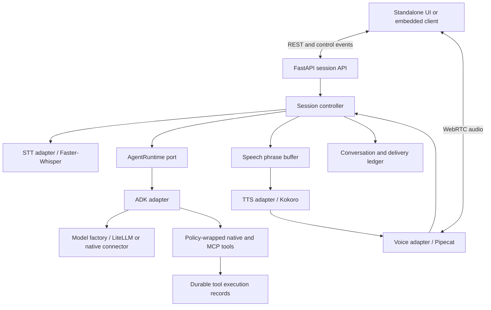

# Standalone Voice Agent — Architecture RFC

Status: architectural target with an initial implementation. Date: 2026-10-10.

Implementation notes: the repository now includes a PostgreSQL-first service, SQLite demo mode,
ADK/LiteLLM provider adapter, native/read-only MCP tools, persisted sessions/playback records,
React client and integration SDK, and optional local Whisper/Kokoro audio with Pipecat Silero VAD.
The first transport uses authenticated PCM/control WebSockets rather than WebRTC. Multi-worker
coordination, multi-user identity provisioning, semantic endpointing, action confirmations for
mutating tools, and automatic conversation summarization remain unimplemented. README.md describes
the executable setup and current behavior; later sections record the architectural target.

## 1. Product boundary

Build a standalone voice application with its own browser interface and a versioned service API. Other applications can later embed its browser client or create voice sessions through the API. Business capabilities arrive through native tools, HTTP adapters, or MCP servers.

The initial cost policy is no additional paid audio APIs. Use the existing Ollama subscription and self-hosted audio workers. Hosting, compute, and Ollama usage limits still apply. Additional paid providers are optional, explicitly configured, and never automatic fallbacks.

Initial assumptions: single user/small pilot, desktop browser first, English first with multilingual evaluation before expansion, one deployment region. Start as a modular monolith plus an audio worker; split services only when measurements justify it.

## 2. Technology decisions

- Python application service with FastAPI for public session/configuration APIs.
- Google ADK behind an application-owned AgentRuntime interface. It owns the LLM/tool reasoning loop.
- LiteLLM library inside the ADK adapter for supported non-Google models. No separate LiteLLM proxy required initially. Native connectors may be used behind the same model factory.
- Pipecat behind the voice adapter for audio transport/pipeline primitives. Validate its self-hosted WebRTC transport in an early spike. Do not add LiveKit as a second orchestration layer initially.
- Silero VAD, Faster-Whisper, and Kokoro as first audio candidates; benchmark rather than promise latency. Keep models warm in bounded workers, never run synchronous inference on the API event loop.
- React/TypeScript browser client, AudioWorklet-based capture/playback where required by the chosen transport SDK, visible transcript, push-to-talk, hands-free mode, mute, stop, and provider selection.
- PostgreSQL from the start for normal local development, testing, and deployment, accessed through SQLAlchemy with Alembic migrations. Provide a local container setup so developers do not need a system-wide PostgreSQL installation. SQLite is an explicit, optional demo mode only. No Redis or broker until multi-worker coordination requires it.
- Local deployment via containers. Credentials remain on the backend; secret values never appear in configuration responses.

ADK supports model connectors and MCP tools, but its documented live audio quickstart requires a compatible Gemini Live API model. Our default architecture uses ADK's text agent loop between independent STT and TTS components. A future native speech-to-speech runtime would be a different adapter with different capabilities, not a model-name substitution.

Sources: [ADK model connectors](https://adk.dev/agents/models/litellm/), [ADK MCP tools](https://adk.dev/tools-custom/mcp-tools/), [ADK live quickstart](https://adk.dev/live/get-started/streaming-python/), [Pipecat](https://docs.pipecat.ai/overview/introduction).

## 3. Component boundaries



Ownership rules:

1. The session controller owns turn IDs, interruption decisions, configuration snapshots, and what can reach playback.
2. ADK owns tool selection and the reasoning loop. Pipecat must not instantiate another LLM/tool loop or independently own conversation history.
3. The ADK adapter maps framework events into application events. Framework types never become public API schemas.
4. The voice adapter reports acoustic events and handles transport. It follows controller generation epochs for cancellation; it does not independently commit conversation turns.
5. Persistent application records own user-visible conversation and tool facts. ADK session state is a projection managed by its adapter. Playback adjustments reconcile this projection before the next run.
6. TTS accepts user-facing speech only. Tool arguments, internal reasoning, and uncommitted candidate output never enter it. If a connector cannot distinguish safe text deltas, wait for an authoritative response rather than speaking speculative text.

## 4. Design patterns and their purpose

| Pattern | Application |
|---|---|
| Ports and adapters | Keep domain/session logic independent of ADK, Pipecat, databases, and provider SDKs. |
| Strategy | Select STT, TTS, turn detection, and LLM behavior through interchangeable implementations. |
| Factory + registry | Construct a runtime from a validated, immutable provider profile. No scattered provider conditionals. |
| Dependency injection | Compose concrete adapters at startup and per session through a small composition root. |
| State machine | Make listening, interruption, switching, reconnects, and errors explicit and testable. |
| Typed events | Decouple streamed reasoning, transcript display, TTS, playback, and metrics using bounded in-process channels. |
| Repository | Persist sessions, conversation delivery, and tool executions behind narrow interfaces. |
| Decorator | Apply authorization, deadlines, audit, and retry rules around every tool execution. |

Do not introduce a generic plugin marketplace, distributed event bus, event sourcing framework, or agent team for the first release. Abstract real substitution points, not every class.

## 5. Contracts

Conceptual Python ports; exact framework APIs are selected during the compatibility spike:

```python
class AgentRuntime(Protocol):
    def run(self, request: TurnRequest) -> AsyncIterator[AgentEvent]: ...
    async def cancel(self, generation_id: str) -> CancellationResult: ...

class Transcriber(Protocol):
    def transcribe(self, frames: AsyncIterator[AudioFrame]) -> AsyncIterator[TranscriptEvent]: ...

class SpeechSynthesizer(Protocol):
    def synthesize(self, segment: SpeechSegment) -> AsyncIterator[AudioFrame]: ...

class ConversationRepository(Protocol):
    async def load_context(self, session_id: str) -> ConversationContext: ...
    async def record_delivery(self, receipt: PlaybackReceipt) -> None: ...
```

The runtime adapter implements cancellation cooperatively. Closing a local stream does not guarantee the provider stopped remote compute; always reject late events independently of upstream cancellation.

Every event carries `schema_version`, `session_id`, `turn_id`, `generation_id` where relevant, `config_revision`, a sequence number, and timestamp. Event types include transcript partial/final, turn committed, safe text delta, tool started/completed/failed/unknown, speech segment ready, playback progress, interrupted, configuration pending/applied/rejected, and error.

Use one serialized command handler per session to prevent races between turn commits, switch requests, and interruptions. Allow bounded inference and tool tasks to run asynchronously. Drop superseded partial transcripts; do not silently drop finalized turns or tool outcomes. Bound audio queues in seconds of playback and propagate backpressure upstream.

## 6. Model selection and live changes

Use named server-side profiles, not arbitrary browser-supplied endpoints or API keys. A profile contains provider, model identifier, endpoint reference, secret reference, deadlines, concurrency budget, context limit, and validated capabilities.

Capabilities include text streaming, tool calling, structured results, cancellation behavior, and tested context size. A model without tool support can run a conversation-only session; reject it for a tool-required profile. Catalog declarations are verified by connector contract tests and representative tool evaluations.

Configuration precedence: deployment defaults < environment < startup flags < authorized session overrides. Session overrides are restricted to allowed profiles and validated settings. Resolve to an immutable revision and snapshot it at turn start. Settings from one user cannot change another user's active session.

Illustrative future commands (not implemented):

```sh
voice-agent serve --llm-profile ollama-cloud --stt faster-whisper --tts kokoro
voice-agent serve --llm-profile local-ollama --interaction push-to-talk
```

Conceptual session update:

```json
{
  "llm_profile": "local-ollama",
  "apply": "next_turn",
  "expected_revision": 7
}
```

Switch semantics:

1. Validate credentials, capabilities, policy, and target availability before accepting the change. A failed validation leaves the current profile intact.
2. Default `next_turn`: finish the existing turn; activate the new revision at the next committed user turn. Never mutate a shared ADK agent instance while it is running.
3. Optional `interrupt_current`: stop playback immediately, invalidate the generation, cancel cancellable computation, and activate the target once tool execution state is reconciled. Report a pending switch if a started action is still unresolved.
4. Rebuild the ADK model/runtime as needed and rehydrate portable context: user turns, delivered assistant speech, and completed tool facts. Preserve tool names, invocation IDs, and results, converting them to the target provider's expected format.
5. Never replay tool calls to reconstruct history. Provider-specific reasoning signatures, caches, and hidden state are not portable; discard or summarize them through the adapter.
6. Do not splice two models into one active response. Any restarted response gets a new generation ID and an explicit restart event.

Fallback is disabled initially. Later fallback must respect cost/data policies, occur at a safe boundary, and avoid replaying side effects. Provider switching changes the inference provider, not STT/TTS automatically.

## 7. Voice session state and interruption

Represent session lifecycle separately from input and output. A single linear listening/thinking/speaking enum is insufficient because a user can speak while audio is playing.

- Lifecycle: connecting, active, reconnecting, closing, closed.
- Input: idle, capturing, finalizing.
- Output: idle, generating, speaking, cancelling.
- Tool invocation state: queued, running, succeeded, failed, cancelled, outcome_unknown.

On a confirmed interruption: issue local playback stop, advance the generation epoch, purge queued audio, cancel TTS/LLM work where supported, and preserve the user's incoming speech. Receivers reject any output belonging to the old epoch, even if it arrives after cancellation.

Do not treat any mic energy as an interruption. Use speech duration/confidence, echo cancellation, and a configurable backchannel policy. Start with deterministic thresholds and tune on recorded scenarios. Silence endpointing and semantic turn completion are different signals; expose them as a TurnDetector strategy.

Maintain generated text separately from delivered speech. Each speech segment has source text, playback duration, and generation ID. Browser receipts report the played offset. Use word alignment when available; otherwise record partial delivery conservatively and mark the boundary uncertain. Never infer that the user heard the whole generated answer. Preserve completed tool facts regardless of interrupted speech.

The STT adapter must handle utterance buffering and partial transcript stability. A Faster-Whisper generator alone is not a real-time streaming protocol. Commit only stable final transcripts to the agent. Add speculative generation later only after cancellation correctness is proven.

The phrase buffer uses sentence/clause boundaries, minimum useful phrase length, and a maximum wait. It handles decimals/abbreviations and flushes on completion. Pace synthesis against a bounded queue. Avoid splitting on every comma or sending arbitrary character counts to TTS.

## 8. Native tools and MCP

Tools have namespaced IDs, schema/version, execution deadline, access scope, side-effect classification, and cancellation/retry policy. Register Python functions first; add approved MCP servers through ADK's McpToolset integration.

All tools, including MCP calls, pass through the policy decorator. Wrap discovered tools or use verified ADK hooks; do not attach an unrestricted toolset that bypasses policy. Credential ownership and connection lifetime follow tenant/user scopes. Local development may use stdio; remote deployments use an authenticated HTTP MCP transport supported by the pinned SDK.

Discover tools outside the audio-critical path. Cache a versioned allowed-tool catalog and snapshot it per turn. Time out unhealthy servers, close connections on shutdown, and surface unavailable tools clearly. Reconnect does not imply retrying a side effect.

For mutations, record an invocation intent before execution, propagate an idempotency key when the external service supports it, and persist the result. A timeout may mean outcome_unknown, not failure. Reconcile unknown outcomes before retrying. Exactly-once execution cannot be guaranteed across arbitrary MCP services.

The LLM proposes actions; application policy authorizes them. Any required user confirmation refers to exact arguments and invocation ID. Speech cancellation never silently changes action authorization or erases execution records.

## 9. Integration API

Proposed API, implemented by our service rather than exposing ADK's development server directly:

| Endpoint | Purpose |
|---|---|
| `GET /v1/capabilities` | Allowed profiles, audio options, and availability; no secrets. |
| `POST /v1/sessions` | Create scoped session with agent profile and optional application context. |
| `GET /v1/sessions/{id}` | Current lifecycle, active/pending configuration, and transcript summary. |
| `PATCH /v1/sessions/{id}/configuration` | Validate and schedule configuration change with expected revision. |
| `POST /v1/sessions/{id}/turns` | Text input; same agent path as voice input. |
| `POST /v1/sessions/{id}/interrupt` | Idempotent interruption for a specific generation. |
| `POST /v1/sessions/{id}/connection` | Short-lived audio connection parameters. |
| `WS /v1/sessions/{id}/events` | Typed control events, transcript, configuration acknowledgments, playback receipts. |
| `DELETE /v1/sessions/{id}` | Close session and release resources; retention handled separately. |

WebRTC carries audio; the event channel carries control and transcript state. Version the protocol independently of ADK/Pipecat. Derive user and tenant identity from authentication, never client JSON. Scope connection tokens to a session, restrict embedding origins, and enforce session access on every operation.

Provide a small TypeScript SDK for connection, events, interrupts, and profile changes. Build the standalone UI on that same SDK so later integration follows a tested path. Host applications supply context and tools through explicit contracts, not imports of server internals. MCP is for capabilities; REST/SDK is for voice session lifecycle. A2A is optional future work only if agent-to-agent delegation is needed.

## 10. Proposed repository layout

```text
apps/web/                      # standalone browser app
packages/client-sdk/           # integration client and event schemas
services/agent/src/voice_agent/
  domain/                      # IDs, events, capabilities, state, tool records
  application/                 # session commands, turn/switch/interrupt use cases
  ports/                       # runtime, audio, persistence contracts
  adapters/
    agents/adk/                # runner, model factory, event/context translation
    voice/pipecat/             # transport and pipeline bridge
    audio/                     # whisper, silero, kokoro implementations
    tools/                     # native tools and policy-wrapped MCP integration
    persistence/               # SQLite/PostgreSQL repositories
  api/                         # REST/control endpoints
  bootstrap.py                 # composition root
config/                        # profiles and non-secret defaults
tests/                         # contracts, race conditions, tool and audio scenarios
deploy/                        # container definitions
docs/                          # implementation decisions and integration guide
```

Dependency direction: adapters and API depend on application/domain contracts; domain code imports no provider/framework packages. Avoid heavyweight inference dependencies in the domain or SDK packages.

## 11. Validation and delivery sequence

1. Compatibility spike: ADK + one Ollama profile, streamed safe text, one native tool, one local test MCP server, cancellation, and reconstruction of context under a second model profile. Verify framework versions and profile-specific behavior before scaffolding around assumptions.
2. Text-only vertical slice: public session API, configuration revisions, durable tool records, adapter contract tests. It must work without a microphone.
3. Voice vertical slice: warm STT/TTS, push-to-talk, playback receipts, bounded buffers, and stop. Add the standalone browser interface through the SDK.
4. Hands-free behavior: speech endpointing, echo tests, interruptions during generation/TTS/tools, stale-output rejection, reconnects, and false-interruption recovery.
5. Integration and deployment: authenticated embedding, isolation between users, load tests, resource limits, and containerized pilot.

Required behavioral tests: switch requested during streaming; simultaneous interrupt and tool completion; delayed audio after cancellation; reconnect with duplicate control events; unknown tool outcome after timeout; malformed MCP output; target model missing tool capability; cross-session isolation; and partial playback reflected in the next prompt. Use model evaluations for tool selection quality, not brittle exact-text assertions.

Measure endpointing delay, final transcript latency, LLM first safe text, TTS first audio, first audible response, playback gaps, confirmed-interruption stop latency, tool latency, queue wait, and p50/p95 under concurrency. Initial goals for simple non-tool turns: median first audible response near one second, p95 below two seconds, and local playback cutoff below 200 ms after confirmed interruption. These are goals to validate on target hardware, not guarantees. Report onset-to-confirmation latency separately.

Track STT/TTS real-time factor and CPU utilization under simultaneous sessions. Never size a VPS from model parameter count alone. Load shedding should give a quick busy response rather than leave voice users waiting in a long hidden queue.

## 12. Database modes and active context

Normal mode uses PostgreSQL as the durable source of truth. Require a PostgreSQL database URL; fail startup with an actionable error if it is absent or unavailable. Never silently fall back to SQLite. Database mode is a deployment setting, not a per-session option.

Provide a local container definition for PostgreSQL with a persistent volume, health check, and documented migration command. Keep credentials outside source control. Run migrations explicitly before serving requests rather than having every worker race to migrate at startup. Production uses managed or self-hosted PostgreSQL with backups and a tested restoration procedure.

Demo mode is selected explicitly, for example `voice-agent serve --mode demo`. It uses a local SQLite file and requires no external database server. It is for a single application process and a small local demonstration. It does not claim parity with PostgreSQL concurrency, locking, or deployment guarantees. Expose the active mode clearly in startup logs and the settings interface. Demo mode changes storage requirements only; audio models and LLM credentials or local inference are still required.

Use the same repository contracts and shared SQLAlchemy mappings where practical. Keep Alembic migrations compatible with both supported dialects for core features, or provide explicit dialect-specific migration branches when necessary. Verify demo migrations separately. Do not flatten production requirements merely to support SQLite; future PostgreSQL-specific capabilities must be marked unavailable or implemented separately in demo mode.

Keep the active session's bounded context in process memory: summary, recent delivered conversation, relevant tool facts, and current configuration revision. Hydrate it from durable records on session start/resume and update it as committed events arrive. Persist finalized turns and playback checkpoints; record tool intent durably before a side effect and its result after execution. Temporary audio frames and provisional transcript fragments need not be persisted. Enforce one owning worker per active session and bound memory usage with idle eviction after pending writes complete. Process memory accelerates active sessions; it is not the recovery source.

Normal integration and concurrency tests run against real PostgreSQL from the first implementation milestone. SQLite is tested as its own demo path, never as a substitute for PostgreSQL validation. Test fresh migrations, upgrades, resume after restart, tool-record durability, and clear failures on invalid mode/URL combinations. Switching a demo installation to PostgreSQL requires an explicit data export/import if history is to be preserved; changing the URL alone does not migrate records.

Redis remains an optional future adapter for shared prepared-context caching and worker coordination. Cached context is versioned and reconstructible from PostgreSQL; action records and authorization decisions remain durable.

## 13. Decisions deliberately deferred

Exact model names, pinned dependency versions, hosting capacity, mobile browser matrix, and supported languages follow the compatibility/audio benchmarks. Vector memory, distributed workers, native speech-to-speech, additional paid providers, and agent teams are optional extensions rather than MVP requirements.

The immediate design choice is settled: a standalone application, PostgreSQL by default with optional SQLite demo mode, active context in process memory, ADK behind an adapter, independent voice orchestration, configuration-driven provider selection, and explicit turn-boundary switching with durable tool facts.
